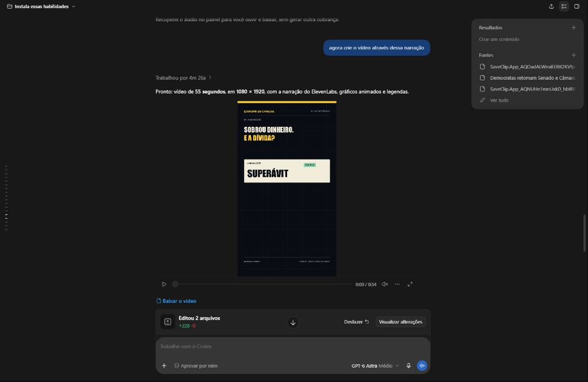
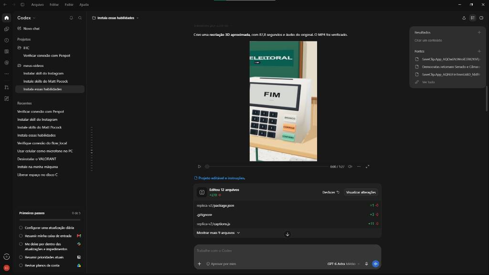
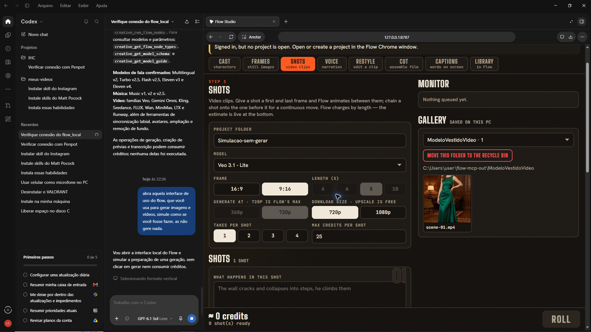
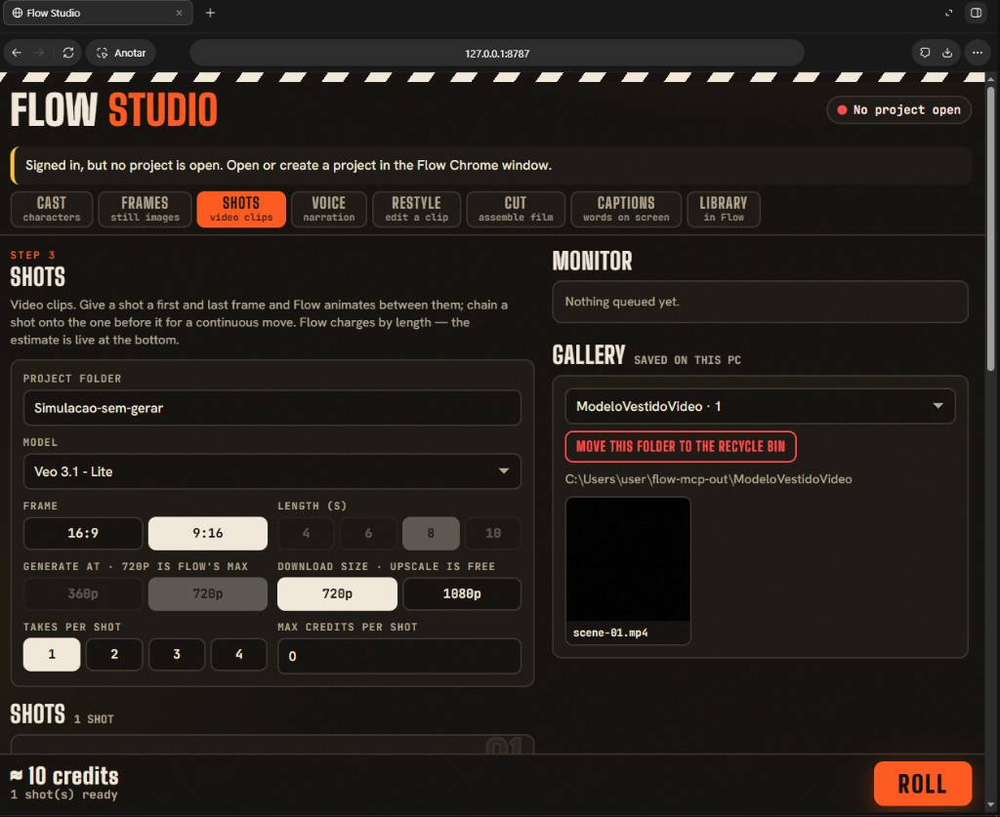

# Automação de vídeos com inteligência artificial

**Projeto pessoal | Inteligência artificial generativa, integração de ferramentas e automação de processos**

## Visão geral

Fluxo experimental de produção audiovisual assistido por IA. A partir de pedidos em linguagem natural ao Codex, utilizo ferramentas integradas para criar vídeos e narrações, diminuindo a necessidade de operar cada etapa separadamente.

## Objetivo

Explorar como agentes e integrações entre ferramentas podem tornar a produção de conteúdo audiovisual mais simples, reproduzível e eficiente.

## Ferramentas e conhecimentos

- **OpenAI Codex:** interface para solicitar e acompanhar tarefas por linguagem natural.
- **ElevenLabs:** geração de voz/narração por IA.
- **Google Flow / Flow Studio:** interface de geração audiovisual e exploração de integração local.
- **MCP (Model Context Protocol):** conexão entre ferramentas no ambiente de automação.
- **Engenharia de prompts e automação:** definição de instruções e coordenação do fluxo.

## Funcionamento demonstrado

1. Envio uma solicitação ao Codex em linguagem natural.
2. O ambiente utiliza as ferramentas configuradas para executar a tarefa.
3. O resultado é disponibilizado para visualização e conferência.
4. Faço a revisão do conteúdo gerado antes de utilizá-lo.

Em uma das execuções documentadas, o Codex informou a criação de um vídeo vertical **1080 × 1920**, com cerca de **55 segundos**, narração do **ElevenLabs**, gráficos animados e legendas. Essa descrição corresponde ao retorno exibido na captura de tela; a visualização do arquivo final deve ser conferida separadamente.

## Evidências visuais

### Solicitação e resultado

### Outro resultado de geração

### Integração com Flow Studio

### Interface do Flow Studio

> As imagens apresentam execuções no Codex e testes de integração com o Flow Studio.

## Vídeos de demonstração

- [Vídeo 1 — Quem manda no Brasil](quem-manda-no-brasil-revisado.mp4)
- [Vídeo 2 — Roteiro 4](roteiro-4-final.mp4)

## Próximos passos

- Documentar a arquitetura da automação.
- Medir o tempo economizado com o processo.
- Expandir as integrações entre ferramentas de IA.

## Autor

**Lhuan Matheus Cabreira**  
Graduando em Engenharia de Software — UFMS
